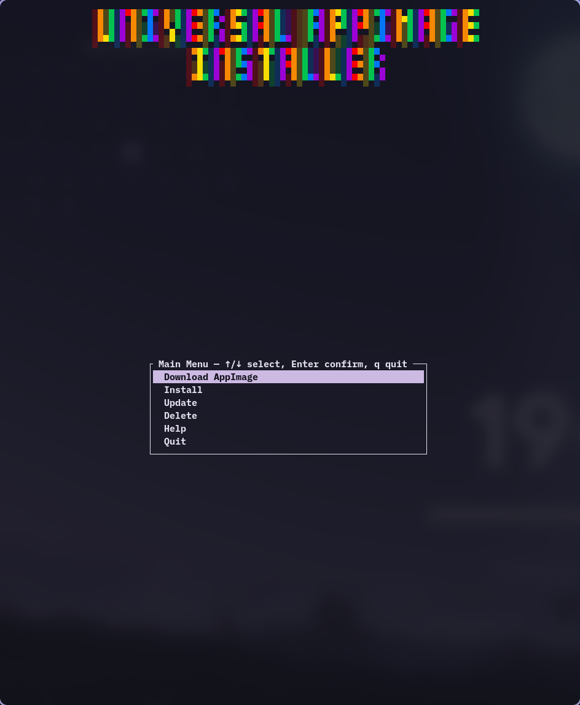
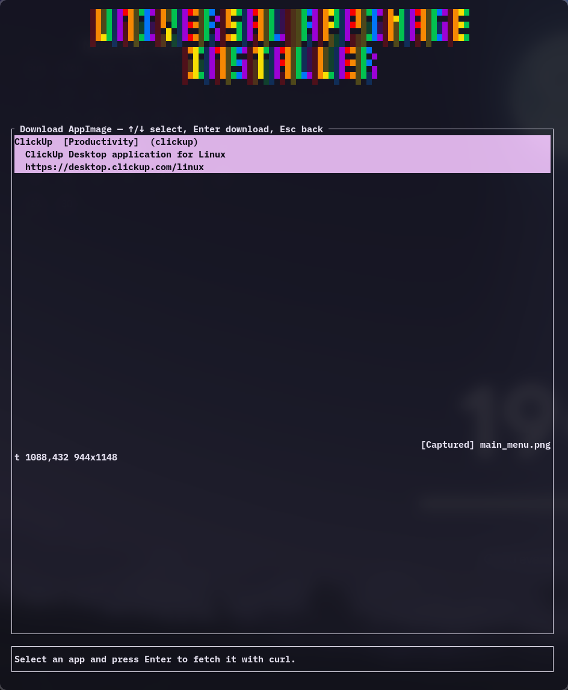
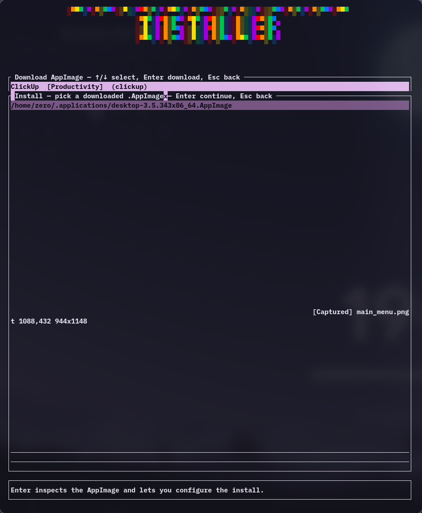
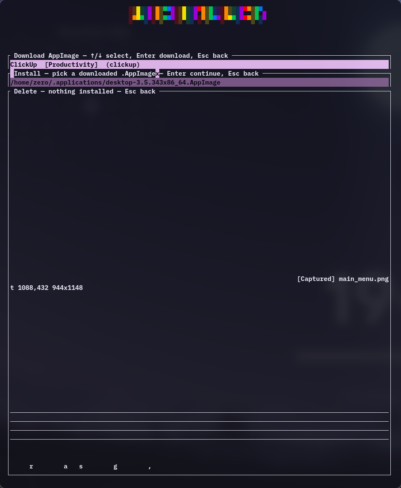

# Universal AppImage Installer (`uai`)

Universal AppImage Installer (`uai`) is an interactive terminal user interface (TUI) application written in Rust designed to download, inspect, install, and manage **AppImage** packages on Linux systems. It seamlessly integrates standalone binaries into your desktop environment with proper `.desktop` application launchers and high-resolution system icons, without requiring external daemon-based tools such as AppImageLauncher.

Originally conceived to streamline the installation of desktop applications like ClickUp, `uai` features an extensible, JSON-driven catalog system capable of downloading and managing any AppImage distribution.

---

## Interface Showcase

| Main Menu | Catalog Downloads |
|:---:|:---:|
|  |  |

| Installation Selection | Integrated Help System |
|:---:|:---:|
|  |  |

---

## Key Features

- **Built-in Catalog & Downloads**: Download AppImages directly from an editable JSON catalog via `curl`, displaying real-time download progress and preserving server-provided filenames.
- **Zero-Execution Metadata Inspection**: Extracts the AppImage payload via `--appimage-extract` into an isolated temporary directory to read the embedded `.desktop` file and icon assets without ever executing untrusted application binaries.
- **Automated Metadata Extraction**: Accurately detects `Name`, `Version` (from `X-AppImage-Version` or filename patterns), `Icon`, `StartupWMClass`, and `MimeType`.
- **Seamless Desktop Integration**: Installs binaries into dedicated user paths (`~/.applications/installed/`), extracts the best matching icon into the `hicolor` theme directory, and writes compliant XDG `.desktop` launchers to `~/.local/share/applications/`.
- **Window Manager & Dock Association**: Links `StartupWMClass` so modern Wayland and X11 compositors (Hyprland, GNOME Shell, KDE Plasma) correctly bind running windows to their taskbar/dock launchers.
- **Advanced Configuration Mode**: Fine-grained control to override the display name, version tag, temporary directory cleanup, or source file retention.
- **Clean Uninstallation**: Removes installed AppImage binaries, generated desktop launchers, and associated icons cleanly after user confirmation.
- **Safe Directory Separation**: Uses `~/.applications` instead of `~/Applications` to prevent conflicts or race conditions with external background watchers like `appimagelauncherd`.

---

## Requirements

| Component | Requirement | Mandatory | Purpose |
|---|---|---|---|
| OS | Linux (x86_64 / aarch64) | Yes | POSIX permissions, XDG Base Directory specification |
| Rust | Stable toolchain (Edition 2024, Rust 1.85+) | Yes (for compilation) | Project compilation and optimization |
| `curl` | Version 7.83 or later | Yes | HTTP file downloads supporting `--clobber` |
| `figlet` / `toilet` | With `pagga` font | No (optional) | Multi-color rainbow ASCII title banner (falls back to bold text) |

On Debian/Ubuntu systems, optional banner dependencies can be installed via:

```bash
sudo apt install curl figlet toilet
```

---

## Building and Installation

`uai` uses no hardcoded paths; all target directories are dynamically derived from standard user directories via the `dirs` crate and created automatically on the first run without needing root (`sudo`) privileges.

### 1. Build and Install via Cargo

```bash
# Clone the repository
git clone https://github.com/zer0sh/universal-appimage-installer.git
cd universal-appimage-installer

# Build and install directly to ~/.cargo/bin
cargo install --path .
```

Ensure `~/.cargo/bin` is present in your shell `$PATH`.

### 2. Manual Release Compilation

```bash
# Compile with optimizations and Link-Time Optimization (LTO)
cargo build --release

# The compiled binary will be placed at target/release/uai
./target/release/uai

# Optionally copy the binary to your local user binary directory
install -Dm755 target/release/uai ~/.local/bin/uai
```

---

## Usage and Navigation

Launch the TUI by running:

```bash
uai
```

### Controls

| Key | Action |
|---|---|
| `Up` / `Down` | Move menu selection or scroll help text |
| `Enter` | Confirm selection or execute current action |
| `Esc` | Return to previous screen or cancel |
| `q` | Quit application (from the main menu) |
| `d` | Trigger deletion for selected installed application |
| `y` / `n` | Confirm or reject prompt dialogs |
| Any Key | Dismiss toast messages and result screens |

### Typical Workflow

1. **Download AppImage**: Navigate to `Download AppImage`, pick an application from the catalog, and press `Enter`. The TUI temporarily yields terminal control to `curl` to display download progress, placing the resulting binary in `~/.applications/`.
2. **Install**: Select `Install` to view all uninstalled AppImages located in `~/.applications/`. Selecting an item extracts its internal metadata without executing the application.
3. **Configure**: Choose **Install now** to apply default extracted metadata, or toggle **Advanced mode** to configure custom overrides:
   - **Custom Name**: Display name used in the desktop launcher.
   - **Custom Version**: Version string embedded in the target filename.
   - **Delete Temp Folder**: Purge extracted squashfs contents after install (default: ON).
   - **Delete Source AppImage**: Remove the uninstalled copy from `~/.applications/` (default: OFF).
4. **Delete**: Browse installed packages, inspect installation timestamps, and press `d` or `Enter` followed by `y` to uninstall.

---

## Path Specifications

Paths follow the XDG Base Directory specification:

| Location | Description |
|---|---|
| `~/.config/universal-appimage-installer/apps.json` | Local user catalog of downloadable applications |
| `~/.local/share/universal-appimage-installer/installed.json` | Registry tracking installed applications and paths |
| `~/.applications/` | Default download directory for uninstalled AppImages |
| `~/.applications/installed/` | Target location for installed AppImages (`<Name>-<Version>.AppImage`) |
| `~/.applications/.tmp/install-<timestamp>/` | Temporary directory used for squashfs extraction and inspection |
| `~/.local/share/applications/<Name>.desktop` | Standard generated desktop application launcher |
| `~/.local/share/icons/hicolor/512x512/apps/` | Extracted application icon |

---

## Extending the Catalog

The default catalog is defined in [`data/apps.json`](data/apps.json) and embedded directly into the binary. On the first launch, it is copied to `~/.config/universal-appimage-installer/apps.json`. You can add new applications by editing this file:

```json
{
  "clickup": {
    "name": "ClickUp",
    "category": "Productivity",
    "description": "ClickUp Desktop application for Linux",
    "homepage": "https://clickup.com",
    "download_url": "https://desktop.clickup.com/linux"
  }
}
```

### Schema

- `name` (string, required): Human-readable name.
- `download_url` (string, required): Direct download URL (HTTP redirects are followed).
- `category` (string, optional): Application category.
- `description` (string, optional): Short summary.
- `homepage` (string, optional): Official website link.

---

## Project Structure

```
.
|-- Cargo.lock
|-- Cargo.toml              # Package definition and dependencies
|-- rust-toolchain.toml     # Rust edition and toolchain configuration
|-- data/
|   `-- apps.json           # Embedded default catalog
|-- docs/
|   `-- images/             # Visual documentation and screenshots
`-- src/
    |-- main.rs             # Application entrypoint, event loop, crossterm terminal setup
    |-- app.rs              # State management and screen state machine
    |-- ui.rs               # Ratatui rendering logic and view layouts
    |-- banner.rs           # Figlet integration and rainbow text colorization
    |-- config.rs           # XDG path discovery and creation
    |-- catalog.rs          # Catalog parsing and loading
    |-- downloader.rs       # External curl downloader integration
    |-- appimage.rs         # Extraction, metadata parsing, file management, and uninstaller
    `-- registry.rs         # JSON database tracking installed applications
```

---

## License

This project is licensed under the standard MIT License or Apache-2.0.
